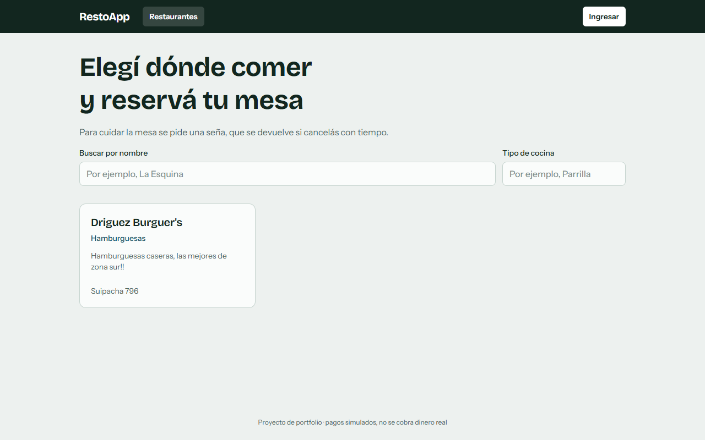
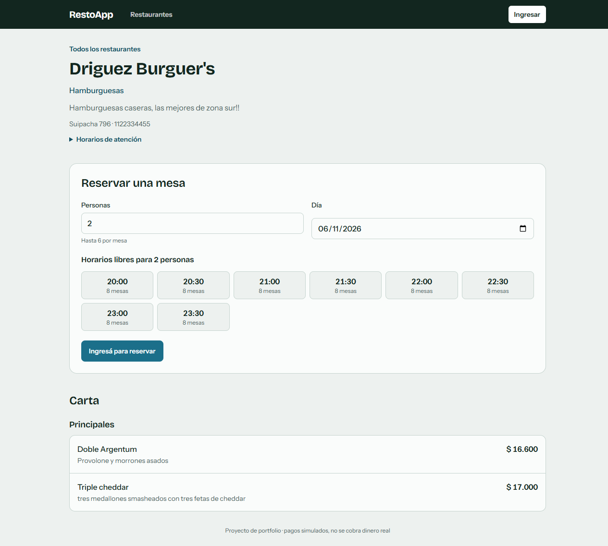
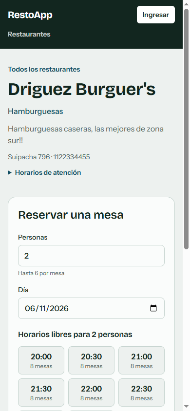

# RestoApp

Plataforma de **reservas de restaurantes con seña**. El cliente elige un restaurante, un día y un horario, paga una seña para retener la mesa y recibe la confirmación. El dueño administra sus locales, la carta y las reservas del día.

Por dentro es un sistema de **microservicios** con NestJS que se coordinan por eventos, el tipo de arquitectura que usan las empresas cuando un solo backend ya no alcanza.

🔗 **Demo en vivo:** https://restoapp.duckdns.org. En «Ingresar» están los botones **Probar como dueño** y **Probar como cliente**, para entrar sin registrarse.

> Los pagos son simulados: no se cobra dinero real. Al pagar la seña se elige un medio de prueba (aprobado, rechazado, lento...) para ver cómo responde el sistema en cada caso.

| Inicio | Restaurante | En el celular |
|---|---|---|
|  |  |  |

## Qué se puede hacer

**Como cliente**

- **Buscar restaurantes** por nombre o tipo de cocina, y ver su carta y sus horarios.
- **Reservar una mesa**: se elige la cantidad de personas y el día, y la app muestra solo los horarios que tienen mesa libre.
- **Pagar la seña**: la mesa queda retenida 15 minutos mientras tanto. Si el pago se rechaza o no se completa a tiempo, la reserva se cancela y la mesa vuelve a estar disponible.
- **Mis reservas**: ver el estado de cada una, pagar las pendientes y cancelar. Cancelando con más de 24 horas de anticipación, la seña se devuelve.
- **Notificaciones**: una bandeja que se llena sola cuando la reserva se confirma, vence, o se cancela por un pago rechazado o porque la canceló el restaurante, y cuando se revisa la solicitud para ser dueño.
- **Pedir ser dueño**: se mandan los datos del local y, cuando un administrador lo aprueba, aparece el panel del dueño sin cerrar sesión.

**Como dueño de un restaurante**

- **Gestionar sus locales**: crear, editar y eliminar restaurantes, con sus mesas y horarios.
- **Armar la carta**: agregar, editar, pausar y quitar platos.
- **Ver las reservas del local**, con un resumen del día por estado, marcar si el cliente vino o no y cancelar (en ese caso la seña se devuelve siempre).

**Como administrador**

- **Revisar las solicitudes para ser dueño**: aprobarlas o rechazarlas con un motivo, que le llega al cliente.

---

## Detalles técnicos

Seis servicios de backend y un frontend, cada uno con su propia responsabilidad y su propia base de datos. El frontend habla con un único punto de entrada (el BFF), y los servicios que necesitan coordinarse lo hacen con eventos por RabbitMQ en vez de llamarse entre sí.

### Stack

| Capa | Tecnología |
|---|---|
| Frontend | React 19, TypeScript, Vite, Tailwind CSS 4, React Query, Redux Toolkit, React Router |
| Backend | NestJS 11 (Node 24), TypeScript |
| Bases de datos | PostgreSQL (TypeORM, con migraciones) y MongoDB (Mongoose) |
| Mensajería | RabbitMQ |
| Caché | Redis |
| Logs | JSON con `correlationId`, Loki y Grafana |
| Testing | Jest, Vitest + Testing Library, integración contra bases y RabbitMQ reales, prueba de punta a punta |
| Infraestructura | Docker, GitHub Actions, GitHub Container Registry, Caddy, VPS en Hetzner |

### Arquitectura

```
Navegador ──▶ Caddy (HTTPS) ──▶ nginx (front) ──▶ web-bff ──┬──▶ auth           (PostgreSQL)
                                                             ├──▶ restaurants    (MongoDB + Redis)
                                                             ├──▶ reservations   (PostgreSQL) ─┐
                                                             ├──▶ payments       (PostgreSQL) ─┼─ RabbitMQ
                                                             └──▶ notifications  (MongoDB) ────┘
```

| Servicio | Qué hace |
|---|---|
| `auth-service` | Registro, login, JWT, roles (cliente, dueño y admin) y solicitudes para ser dueño |
| `restaurants-service` | Restaurantes, mesas, horarios y carta, con caché en Redis |
| `reservations-service` | Disponibilidad, reservas, seña y vencimiento |
| `payments-service` | Cobro de la seña, webhooks de la pasarela y reembolsos |
| `notifications-service` | Escucha los eventos de reservas y de las solicitudes para ser dueño, y arma la bandeja de avisos |
| `web-bff` | Única puerta del frontend: valida el JWT y junta datos de varios servicios |

### Cómo funciona una reserva con seña

1. El cliente reserva: `reservations-service` guarda la reserva como pendiente de pago y retiene la mesa. En la misma transacción deja anotado el evento `reservation.created`.
2. Ese evento llega por RabbitMQ a `payments-service`, que crea el pago pendiente.
3. El cliente paga. La pasarela responde al instante, o avisa más tarde con un **webhook firmado**.
4. `payments-service` publica `payment.succeeded`, la reserva pasa a confirmada y `reservations-service` publica `reservation.confirmed`. Con ese evento, `notifications-service` le deja el aviso al cliente.
5. Si el pago se rechaza, la reserva se cancela y la mesa se libera. Si nadie paga a tiempo, vence sola.

Ningún servicio llama a otro para esto: si `payments-service` se cae un rato, las reservas se siguen tomando y los eventos esperan hasta que vuelva.

### Decisiones destacadas

- **Imposible reservar la misma mesa dos veces**, aunque dos personas aprieten "Reservar" en el mismo instante. Lo garantiza la base de datos con una restricción de exclusión de PostgreSQL, no un "¿está libre?" en el código, que falla con pedidos simultáneos. Lo prueban tests de integración con pedidos concurrentes.
- **Ningún evento se pierde ni se aplica dos veces.** Los eventos se guardan en la misma transacción que el cambio (*transactional outbox*) y se publican después, y cada consumidor registra lo que ya procesó. Los mensajes que fallan se reintentan y, si no hay caso, van a una cola aparte para revisarlos.
- **Nunca se cobra dos veces**, ni con doble click ni con reintentos por mala conexión: cada pago lleva una `Idempotency-Key`, y repetirla devuelve el mismo resultado sin volver a cobrar.
- **Cada usuario ve solo lo suyo.** Todo se filtra por el usuario del token, y pedir la reserva de otro responde 404, igual que si no existiera.
- **Medido antes de optimizar.** La pantalla "Mis reservas" pasó de **34 llamadas internas a 3**, y su tiempo de respuesta (p95) bajó un 82 %. Con el caché en Redis, a 100 pedidos por segundo los errores bajaron de **7,8 % a 0 %** y el p95 de **6,1 s a 28 ms**.
- **Un pedido se puede seguir de punta a punta**: el `correlationId` viaja por HTTP y por los eventos, así que en Grafana se ve el recorrido completo de una reserva por todos los servicios.

### Seguridad

- **Login con límite de intentos por IP**, y la IP es la real aunque haya dos proxies adelante: un `X-Forwarded-For` inventado no lo saltea.
- **Headers de seguridad** en todas las respuestas: CSP estricta, HSTS, protección contra iframes.
- **Los servicios no arrancan con secretos débiles** ni con los valores de ejemplo, y en producción no hay contraseñas por defecto.
- **En producción solo Caddy está expuesto a internet.** Bases, RabbitMQ y servicios quedan en la red interna de Docker.
- **Webhooks autenticados con firma HMAC** sobre el cuerpo exacto, con protección contra repeticiones.

### Calidad y CI/CD

- **En cada pull request** corren lint, los tests unitarios de los 7 paquetes, los de integración contra PostgreSQL, RabbitMQ y Redis reales, el build de las imágenes y una prueba de punta a punta. Esa prueba levanta el sistema completo con Docker y recorre la saga de la seña y la solicitud para ser dueño con 122 verificaciones.
- **Al mergear a `main`** se publican las imágenes en GitHub Container Registry, solo si el CI pasó. El servidor usa esas mismas imágenes.
- **Dependabot** mantiene las dependencias al día.

### Correr en local

Requisitos: Node 24+ y Docker.

```bash
git clone https://github.com/AgustinRodriguez23/RestoApp.git
cd RestoApp
cp .env.example .env    # cambiá JWT_SECRET y GATEWAY_WEBHOOK_SECRET: openssl rand -hex 32
npm install
npm run up              # todo en contenedores: http://localhost:5173
```

Cada servicio expone su Swagger en `/docs`; el del BFF queda en http://localhost:3000/docs.

```bash
npm test                # unitarios de todos los servicios
npm run test:integration    # antes: npm run infra:up (bases y RabbitMQ)
npm run test:e2e        # la saga completa contra el sistema en marcha
npm run lint
```

### Deploy

Corre en un VPS de Hetzner con `docker-compose.prod.yml`. Caddy pide y renueva solo el certificado HTTPS, y el servidor baja las imágenes ya publicadas por el CI en vez de construirlas. Las bases se respaldan todas las noches con un script y `cron`.

Cómo se actualiza, se vuelve a una versión anterior, se miran los logs y se restaura un backup: [`docs/OPERACION.md`](./docs/OPERACION.md).

### Documentación técnica

El detalle de cada decisión, con las alternativas que se descartaron, las mediciones y las limitaciones conocidas, está en [`docs/ARQUITECTURA.md`](./docs/ARQUITECTURA.md). Las pruebas de carga se pueden repetir con el kit de [`perf/`](./perf/README.md).

### Próximos pasos

- **Cobro real con Mercado Pago**: la pasarela ya está detrás de una interfaz, así que sumarla no cambia el resto del servicio.
- **La cuenta de la mesa**: registrar lo consumido, descontar la seña y cobrar con QR.

## Contacto

**Agustín Rodríguez** · Desarrollador full stack

📧 agustinlihuel@gmail.com
💼 [LinkedIn](https://www.linkedin.com/in/agustin-lihuel-rodr%C3%ADguez-9968b7353/)
🐙 [GitHub](https://github.com/AgustinRodriguez23)
